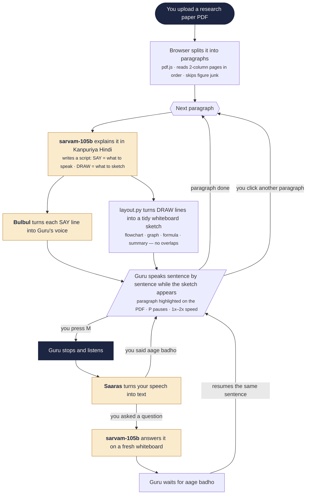

# Guru — paper samjho, Kanpur style

Upload a research-paper PDF. A teacher, "Guru", explains it **one paragraph at a time, slowly, in a Kanpuriya Hindi voice**, and draws on a whiteboard beside the paper as he talks.

- The current paragraph is highlighted on the PDF. Click any paragraph to start from there.
- Each sentence he speaks has its own drawing (boxes, arrows, graphs), which animates onto the board while he says it.
- **Interrupt any time by pressing `M`**: he stops, you ask your question out loud (like "embedding ka matlab?"), and you press `M` again to send it. He answers on a fresh board, then waits.
- Say or type **"aage badho"** (or click ▶ Aage badho) and he goes back to the paragraph's board and carries on from the sentence where you stopped him. You can also ask another question first.

## How it works



Dark boxes are things you do; marigold boxes are Sarvam AI models. While you listen to one paragraph, the next one is already being prepared, so there's no wait between them.

## Powered by Sarvam AI

| Job | Sarvam model |
|---|---|
| Explanations and doubt answers | `sarvam-105b` (chat completions, reasoning off for ~1–2 s replies) |
| Voice | `bulbul:v3` text-to-speech, `hi-IN`, speaker `shubh` (set `TTS_SPEAKER` to change it) |
| Listening to your questions | `saaras:v4` speech-to-text, `codemix` mode (handles Hindi and English mixed together) |

The PDF is parsed in the browser with pdf.js, which handles one- and two-column layouts, headings and hyphenation, and stops at References. The model writes a small script of `SAY:` and `DRAW:` lines. It never gives coordinates: [`layout.py`](layout.py) decides where everything goes and turns it into SVG.

## Run

```bash
cp .env.example .env    # then put your SARVAM_API_KEY in .env
./run.sh                # opens on http://localhost:8765
```

Needs Python 3.9 or newer. Use Chrome, because the 🎤 button needs microphone permission. To try the UI without calling Sarvam, set `MOCK=1`.

## Files

- `server.py`: FastAPI app. It serves `/api/explain`, `/api/ask`, `/api/tts` and `/api/stt`, plus the prompts.
- `layout.py`: the whiteboard language. The model says *what* to draw (`TITLE`, `NODE`/`LINK` flowchart, `FORMULA`, `NOTE`, `GRAPH`/`PLOT`, `SAAR`) and this lays it out in fixed zones, so nothing overlaps.
- `draw.py`: text measuring and the older coordinate commands, still accepted as a fallback.
- `static/`: the UI (`index.html`, `app.js`, `style.css`).
