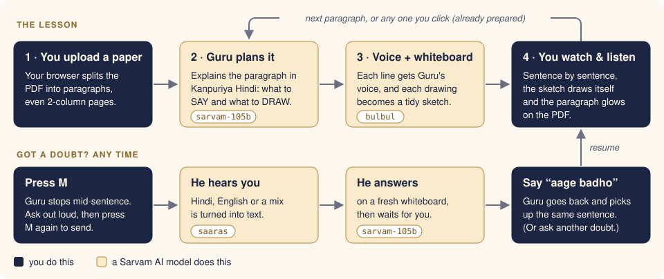
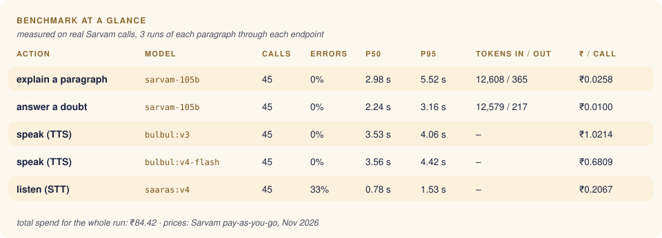
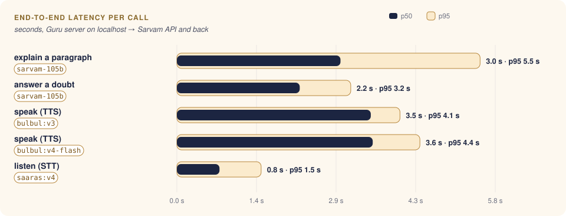
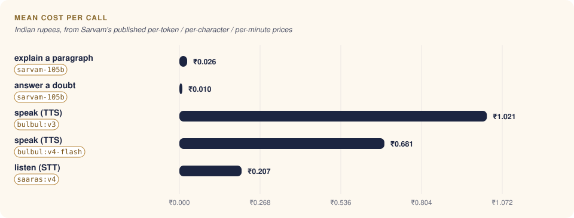

# Guru — paper samjho, Kanpur style

Upload a research-paper PDF. A teacher, "Guru", explains it **one paragraph at a time, slowly, in a Kanpuriya Hindi voice**, and draws on a whiteboard beside the paper as he talks.

- The current paragraph is highlighted on the PDF. Click any paragraph to start from there.
- Each sentence he speaks has its own drawing (boxes, arrows, graphs), which animates onto the board while he says it.
- **Interrupt any time by pressing `M`**: he stops, you ask your question out loud (like "embedding ka matlab?"), and you press `M` again to send it. He answers on a fresh board, then waits.
- Say or type **"aage badho"** (or click ▶ Aage badho) and he goes back to the paragraph's board and carries on from the sentence where you stopped him. You can also ask another question first.

## How it works

<p align="center">
  
</p>

While you listen to one paragraph, the next one is already being prepared, so there's no wait between them.

## Powered by Sarvam AI

| Job | Sarvam model |
|---|---|
| Explanations and doubt answers | `sarvam-105b` (chat completions, reasoning off for ~1–2 s replies) |
| Voice | `bulbul:v4-flash` text-to-speech, `hi-IN`, speaker `shubh_enhi_banking` (a Hindi–English code-mixed voice; set `TTS_SPEAKER` to change it, plain v3 names like `varun` also work) |
| Listening to your questions | `saaras:v4` speech-to-text, `codemix` mode (handles Hindi and English mixed together) |

The PDF is parsed in the browser with pdf.js, which handles one- and two-column layouts, headings and hyphenation, and stops at References. The model writes a small script of `SAY:` and `DRAW:` lines. It never gives coordinates: [`layout.py`](guru/whiteboard/layout.py) decides where everything goes and turns it into SVG.

## Model issues and fixes

Problems hit with each Sarvam model while building Guru, and how they were worked around.

**`sarvam-105b`**

| Issue | Fix |
|---|---|
| With thinking on, replies were slow and reasoning used up the `max_tokens` budget, which sometimes left no lesson text. | Reasoning is turned off (`reasoning_effort: null`), which gives replies in about 1–2 s and keeps the whole budget for the answer. |
| It was bad at whiteboard coordinates: giant boxes, arrows pointing at nothing, and text piled up at the bottom. | The model now only says *what* to draw (`TITLE`, `NODE`/`LINK`, `FORMULA`, `NOTE`, `GRAPH`/`PLOT`, `SAAR`). The server lays everything out in fixed zones, and no board overlaps. |
| Sometimes Sarvam returned a 503 (overloaded), or the reply had no usable `SAY:` lines. | `call_llm` retries up to 3 times, and the error it raises includes the `finish_reason`. |
| The context window is 128K tokens, and long papers (GPT-3) don't fit. | The paper sent as context is cut at 120K characters. Because the same system prompt and paper go out on every call, about 89% of input tokens are billed at the cached rate. |

**Bulbul (`bulbul:v4-flash`, `bulbul:v3`)**

| Issue | Fix |
|---|---|
| v4 Flash speakers (`shubh_enhi_banking`) and v3 speakers (`varun`, `shubh`) only work with their own model. | The model is picked from the speaker name: names in the form `name_lang_style` use `bulbul:v4-flash`, and plain names use `bulbul:v3`. |
| Changing speed through Bulbul's `pace` meant generating the audio again. | The speed buttons (1x to 2x) change the browser's playback rate instead, with pitch preserved, so a change applies at once, even mid-sentence. |

**`saaras:v4`**

| Issue | Fix |
|---|---|
| Sarvam rejected Chrome's recording type, `audio/webm;codecs=opus`. | `/api/stt` sends just `audio/webm`, and if Sarvam still rejects it, resends as `application/octet-stream`. |
| Real-time STT rejects audio over 30 s, so a long spoken doubt fails (the benchmark found 15 of 45 failures, all on clips of 31.6 s or more). | **Not fixed yet.** The plan is to cap recordings at about 28 s in `app.js`, or send longer clips to the batch API, and to retry as octet-stream only on content-type errors, since that retry currently doubles every failed call. |

## Run

```bash
cp .env.example .env    # then put your SARVAM_API_KEY in .env
./run.sh                # opens on http://localhost:8765
```

Needs Python 3.9 or newer. Use Chrome, because the 🎤 button needs microphone permission. To try the UI without calling Sarvam, set `MOCK=1`.

## Benchmark results

Every Sarvam-backed endpoint was measured on real calls: 5 classic AI papers (Transformer, BERT, GPT-3, ResNet, DDPM) × 3 paragraphs each (abstract, method, results) × 3 runs. That's 225 calls in total, run on a MacBook Air on 27 Nov 2026, for a total cost of ₹84.42 (≈ $0.90).

<p align="center">
  
</p>

<p align="center">
  
</p>
<p align="center">
  
</p>

- **The voice is 91% of the cost.** All the LLM calls together cost ₹1.61. `bulbul:v4-flash` is 33% cheaper than v3 at the same latency, so it stays the default.
- **Prompt caching makes the LLM cheap.** About 89% of input tokens were billed at the cached rate.
- **Sarvam's real-time STT rejects audio over 30 s,** so a long spoken doubt fails. The fix is to cap the recording length or use the batch API.

Method, pricing sources, per-paper numbers and recommendations are in [benchmarks/RESULTS.md](benchmarks/RESULTS.md). To re-run: `.venv/bin/python benchmarks/run_benchmark.py`.

## Files

```
Guru/
├── guru/                  Python package (the app)
│   ├── server.py          FastAPI app: /api/explain, /api/ask, /api/tts, /api/stt, plus the prompts
│   ├── whiteboard/        the whiteboard language -> SVG
│   │   ├── layout.py      semantic commands, laid out in fixed zones
│   │   └── draw.py        text measuring and the older coordinate commands
│   └── static/            the UI (index.html, app.js, style.css)
├── tests/                 regression tests (python -m unittest)
├── benchmarks/            API usage/latency/cost benchmark (run_benchmark.py, RESULTS.md)
├── docs/                  README images (HLD + benchmark charts)
├── run.sh                 one-time setup + run
├── requirements.txt
└── .env.example
```

- `guru/server.py`: FastAPI app. It serves `/api/explain`, `/api/ask`, `/api/tts` and `/api/stt`, plus the prompts.
- `guru/whiteboard/layout.py`: the whiteboard language. The model says *what* to draw (`TITLE`, `NODE`/`LINK` flowchart, `FORMULA`, `NOTE`, `GRAPH`/`PLOT`, `SAAR`) and this lays it out in fixed zones, so nothing overlaps.
- `guru/whiteboard/draw.py`: text measuring and the older coordinate commands, still accepted as a fallback.
- `guru/static/`: the UI (`index.html`, `app.js`, `style.css`).

## Tests

```bash
.venv/bin/python -m unittest discover -s tests -v
```

They run in mock mode, so they need no API key and make no calls to Sarvam.
