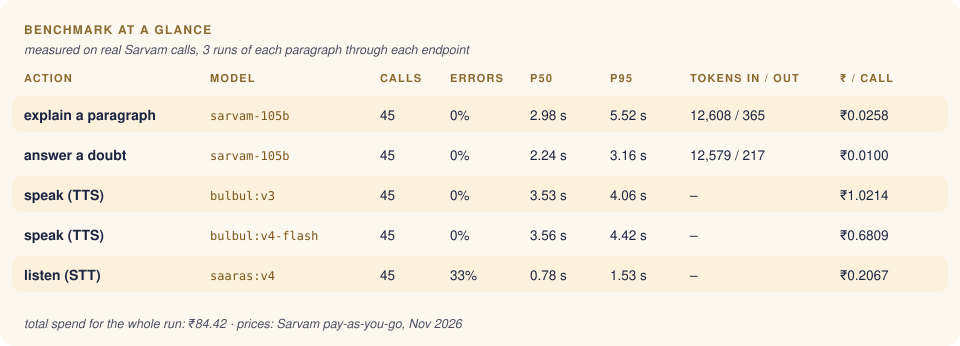
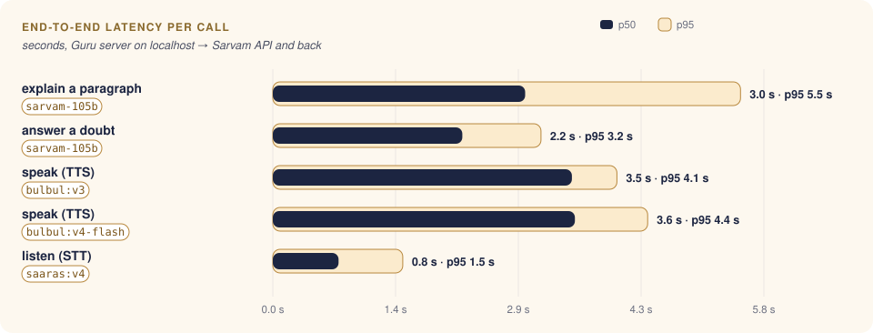
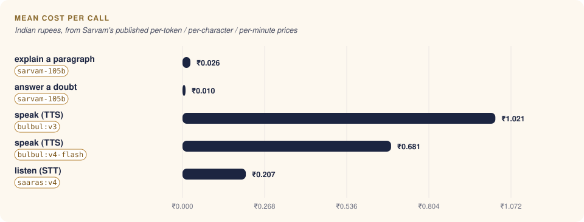

# Guru API benchmark: Sarvam AI usage, latency and cost

Run `20261127T071718Z` · 27 Nov 2026 · 225 calls · total spend **₹84.42 (≈ $0.90)**

<p align="center">
  
</p>

Every number here comes from real calls made in this run. Nothing is estimated. The few derived figures (marked *derived*) are plain arithmetic on the measured means, and the formula is shown next to each one.

## TL;DR

- **The voice is the bill.** Text-to-speech was **₹76.61 of the ₹84.42 total (91%)**. All 90 LLM calls together cost **₹1.61**. One TTS call (about 340 characters) costs about 26× one `explain` call on v4-flash, and about 40× on v3.
- **Keep `bulbul:v4-flash`.** Its latency matched `bulbul:v3` (p50 3.56 s vs 3.53 s) and it costs **33% less per character** (₹2 vs ₹3 per 1K chars).
- **Prompt caching does most of the LLM saving.** About 89% of `explain` input tokens (11,218 of 12,608 on average) were billed at the cached rate, because Guru sends the same system prompt plus full paper on every call. A mean `explain` cost ₹0.026. At the uncached rate it would have cost about ₹0.135 (*derived*: 12,608 × ₹10/M + 365 × ₹25/M).
- **The LLM is fast enough to hide.** `explain` p50 is 2.98 s and p95 5.52 s, and every call succeeded. Guru prepares the next paragraph while the current one plays (about a minute of audio, see below), so the student never waits on the model after the first paragraph.
- **STT has a hard 30-second limit, and Guru doesn't guard against it.** 15 of 45 `stt` calls failed with Sarvam's *"Audio duration exceeds the maximum limit of 30 seconds"*. Every clip of 31.6 s or more failed, and every clip of 29.7 s or less passed. The server also retries that 400 with a different content type, so each failure cost 2 upstream calls. A spoken doubt longer than 30 s would fail the same way in the app.

## What was benchmarked

Guru's server (`guru/server.py`) exposes four AI-backed endpoints, and all of them call Sarvam AI:

| Endpoint | What it does | Sarvam model | Benchmarked as |
|---|---|---|---|
| `POST /api/explain` | Explains one paragraph as a SAY/DRAW lesson script | `sarvam-105b` (chat completions, `reasoning_effort: null`, `max_tokens` 3000, temperature 0.7) | `explain` |
| `POST /api/ask` | Answers a student's doubt about the current paragraph | `sarvam-105b` | `ask` |
| `POST /api/tts` | Voices a narration line | `bulbul:v4-flash` (speaker `shubh_enhi_banking`, default) or `bulbul:v3` (plain speaker names such as `shubh`) | `tts` × both models |
| `POST /api/stt` | Turns the student's spoken doubt into text | `saaras:v4`, `codemix` mode | `stt` |

`/api/render` and `/api/health` make no model calls and were not benchmarked. No endpoint streams, so **time-to-first-token is not applicable** and the `ttft_ms` column is empty.

## Method

1. **Real server, real HTTP.** `benchmarks/run_benchmark.py` imports `guru.server:app`, starts it with uvicorn on a random localhost port, and sends every request over HTTP, the same way the browser does. Latency is end-to-end: client → Guru → Sarvam → Guru → client.
2. **Upstream capture.** An httpx event hook on the server's own client records each Sarvam response. That gives Sarvam's `usage` block (prompt, cached, completion and reasoning tokens), `finish_reason`, upstream time and the number of upstream calls (which counts retries).
3. **Inputs.** The 5 papers came from ar5iv (arXiv's HTML rendering). From each paper the script takes three paragraphs with a fixed, deterministic rule: the abstract, the first 450–1000-character paragraph under a method-style heading, and the longest paragraph of 3000 characters or less under a results-style heading. The selection is frozen in [`inputs/paragraphs.json`](inputs/paragraphs.json) (with text, section and SHA-256), so re-runs use exactly the same inputs. The paper text sent as context is every body paragraph (references excluded), the same as what the UI sends. The server truncates it at 120K characters.
4. **Per action:**
   - **explain:** paragraph + full paper context.
   - **ask:** the same, plus one fixed Hinglish question per paragraph from [`inputs/questions.json`](inputs/questions.json).
   - **tts:** the first whole sentences, up to 400 chars, of Guru's own narration from the first `explain` of that paragraph, at pace 0.9. The same text goes to both voices.
   - **stt:** the `bulbul:v4-flash` audio from the TTS step, sent back in. This round trip gives a similarity score (difflib ratio after normalisation) between Guru's text and the transcript.
5. **Repetitions:** each paragraph × action × model was run 3 times, one call at a time: 15 paragraphs × 5 action/model pairs × 3 = 225 calls.
6. **Cost:** cost uses Sarvam's published pay-as-you-go prices (below):
   - **LLM:** (uncached input × input rate) + (cached input × cached rate) + (output × output rate).
   - **TTS:** characters sent × per-character rate.
   - **STT:** audio seconds, measured from the MP3 frames, × per-minute rate.
   - **Failed calls:** recorded with no cost.
   - USD uses ₹94 = $1.

### Environment

| | |
|---|---|
| Machine | MacBook Air (Apple silicon, arm64), macOS 26.3.1. The benchmark ran on the laptop, not in the cloud |
| Python | 3.9.6 (the repo's `.venv`) |
| Guru commit | `aa8d704` (branch `benchmarks/api-usage-2026-11-27`) |
| Server config | `MOCK=0`, model `sarvam-105b`, voice `shubh_enhi_banking` → `bulbul:v4-flash` |
| Network | Home internet to `api.sarvam.ai`. Latency includes that network path |

### Papers and paragraphs

| Paper | arXiv | Paragraph | Section | Chars |
|---|---|---|---|---:|
| Attention Is All You Need (Vaswani et al., 2017) | [1706.03762](https://arxiv.org/abs/1706.03762) | short_abstract | Abstract | 1,139 |
| | | medium_method | 2 Background | 825 |
| | | long_results | 6.1 Machine Translation | 515 |
| BERT (Devlin et al., 2018) | [1810.04805](https://arxiv.org/abs/1810.04805) | short_abstract | Abstract | 1,067 |
| | | medium_method | 2.1 Unsupervised Feature-based Approaches | 655 |
| | | long_results | 4.2 SQuAD v1.1 | 954 |
| Language Models are Few-Shot Learners (Brown et al., 2020) | [2005.14165](https://arxiv.org/abs/2005.14165) | short_abstract | Abstract | 1,789 |
| | | medium_method | 2 Approach | 768 |
| | | long_results | 3.3 Translation | 1,474 |
| Deep Residual Learning (He et al., 2015) | [1512.03385](https://arxiv.org/abs/1512.03385) | short_abstract | Abstract | 1,296 |
| | | medium_method | 3.1 Residual Learning | 930 |
| | | long_results | 4.2 CIFAR-10 and Analysis | 966 |
| Denoising Diffusion Probabilistic Models (Ho et al., 2020) | [2006.11239](https://arxiv.org/abs/2006.11239) | short_abstract | Abstract | 797 |
| | | medium_method | 2 Background | 848 |
| | | long_results | 4.2 Reverse process parameterization and training | 834 |

The paragraph ids describe *where* a paragraph came from: abstract, method section or results section. The lengths still vary from 515 to 1,789 characters. In some papers the abstract is the longest of the three, because ar5iv's paragraph splitting keeps results paragraphs short. The per-length table below therefore groups by role, and the character counts are listed so you can see the actual sizes.

### Pricing used (INR, excl. GST)

| Model | Price | Source |
|---|---|---|
| `sarvam-105b` | ₹10 / 1M input tokens · ₹0.25 / 1M cached input · ₹25 / 1M output (reasoning tokens billed as output). *Introductory pricing, valid through end of 2026* | [docs.sarvam.ai pricing](https://docs.sarvam.ai/api/getting-started/pricing), [sarvam.ai/api-pricing](https://www.sarvam.ai/api-pricing) |
| `bulbul:v4-flash` | ₹2 / 1K characters | same |
| `bulbul:v3` | ₹3 / 1K characters | same |
| `saaras:v4` (real-time STT) | ₹0.49 / minute, billed per second. No separate price published for `codemix` mode | same |
| FX | ₹94 ≈ $1 (mid-market, late Nov 2026) | [MarketXLS USD/INR](https://marketxls.com/indicators/usd-to-inr-exchange-rate) |

Prices were read on 27 Nov 2026. `PRICING` in `run_benchmark.py` holds them. Update it and re-run when the introductory rate ends.

## Results

### Summary per model × action

| Action | Model | Calls | Error rate | p50 latency | p95 latency | Mean in / out tokens | Mean cost / call | Total cost |
|---|---|---:|---:|---:|---:|---:|---:|---:|
| `explain` | sarvam-105b | 45 | 0.0% | 2.98 s | 5.52 s | 12,608 / 365 | ₹0.0258 ($0.00028) | ₹1.16 ($0.012) |
| `ask` | sarvam-105b | 45 | 0.0% | 2.24 s | 3.16 s | 12,579 / 217 | ₹0.0100 ($0.00011) | ₹0.45 ($0.005) |
| `tts` | bulbul:v4-flash | 45 | 0.0% | 3.56 s | 4.42 s | – | ₹0.6809 ($0.00724) | ₹30.64 ($0.326) |
| `tts` | bulbul:v3 | 45 | 0.0% | 3.53 s | 4.06 s | – | ₹1.0214 ($0.01087) | ₹45.96 ($0.489) |
| `stt` | saaras:v4 | 45 | 33.3% | 0.78 s | 1.53 s | – | ₹0.2067 ($0.00220) | ₹6.20 ($0.066) |

<p align="center">
  
</p>

<p align="center">
  
</p>

### More metrics

| Action | Model | Mean latency | Max latency | Sarvam (upstream) mean | Output tok/s | Mean cached input tok | Extra upstream calls | Mean output | Audio s | Real-time factor | STT similarity | ₹ per 1K input chars |
|---|---|---:|---:|---:|---:|---:|---:|---:|---:|---:|---:|---:|
| `explain` | sarvam-105b | 3,325 ms | 6,566 ms | 3,313 ms | 117.6 | 11,218 | 0 | 762 chars, 6.5 steps | – | – | – | ₹0.0261 |
| `ask` | sarvam-105b | 2,262 ms | 3,608 ms | 2,250 ms | 101.1 | 12,431 | 0 | 442 chars, 4.4 steps | – | – | – | ₹0.0101 |
| `tts` | bulbul:v4-flash | 3,594 ms | 4,840 ms | 3,575 ms | – | – | 0 | 450 KB mp3 | 28.1 | 0.13 | – | ₹2.0000 |
| `tts` | bulbul:v3 | 3,436 ms | 4,319 ms | 3,421 ms | – | – | 0 | 374 KB mp3 | 23.4 | 0.15 | – | ₹3.0000 |
| `stt` | saaras:v4 | 854 ms | 1,548 ms | 842 ms | – | – | 15 | 321 chars | 25.3 | 0.03 | 0.90 | ₹0.6395 |

Column notes:

- **Real-time factor** is latency ÷ audio duration, so lower is faster than real time.
- **Output tok/s** is completion tokens ÷ Sarvam upstream time. Because the call doesn't stream, this includes prompt processing.
- **Guru's own overhead** is end-to-end minus upstream, about 12–20 ms per call.
- **₹ per 1K input chars** uses the paragraph length for LLM calls, the narration length for TTS, and the source-text length for STT.

### By paper (LLM)

| Paper | explain p50 | explain mean input tok | explain mean ₹ | ask p50 | ask mean ₹ |
|---|---:|---:|---:|---:|---:|
| transformer | 2.94 s | 6,989 | ₹0.0185 | 2.43 s | ₹0.0089 |
| bert | 5.02 s | 11,655 | ₹0.0237 | 1.74 s | ₹0.0094 |
| gpt3 | 2.74 s | 27,373 | ₹0.0465 | 2.38 s | ₹0.0135 |
| resnet | 2.97 s | 8,622 | ₹0.0205 | 2.12 s | ₹0.0091 |
| ddpm | 3.04 s | 8,404 | ₹0.0199 | 2.51 s | ₹0.0091 |

Input tokens follow paper length, because the whole paper goes in as context. GPT-3 hits the server's 120K-character cut, about 27K tokens. Latency hardly moves with prompt size: GPT-3's 27K-token prompt had a *lower* p50 than ResNet's 8.6K, which fits with cached prefixes doing the heavy lifting. BERT's `explain` p50 of 5.0 s is the outlier. 5 of its 9 calls took 5.0–6.6 s, spread over all three paragraphs, with almost the same token counts and cache hits as its fast calls. That points to upstream variance during those ~30 s rather than anything about the input. A re-run would show whether it repeats.

### By paragraph role

| Paragraph | Mean chars | explain p50 | explain mean output tok | tts v4-flash p50 | tts v3 p50 |
|---|---:|---:|---:|---:|---:|
| short_abstract | 1,218 | 2.95 s | 401 | 3.26 s | 2.99 s |
| medium_method | 805 | 2.98 s | 341 | 3.49 s | 3.60 s |
| long_results | 949 | 3.01 s | 352 | 3.97 s | 3.78 s |

Paragraph length barely changes `explain` latency (about 3.0 s for every role). The prompt asks for 4–8 SAY steps whatever the length, so output size, and with it latency, stays roughly flat.

### Errors

All 15 failures were `stt` calls on clips longer than 30 s:

| Paper | Paragraph | Audio | Result (3 runs each) |
|---|---|---:|---|
| transformer | long_results | 34.1 s | 3 × HTTP 502 ← Sarvam 400 *"Audio duration exceeds the maximum limit of 30 seconds. Please use the batch API…"* |
| gpt3 | long_results | 31.6 s | same |
| resnet | long_results | 36.9 s | same |
| ddpm | medium_method | 35.0 s | same |
| ddpm | long_results | 34.4 s | same |

The longest clip that succeeded was 29.7 s (bert short_abstract). The `explain`, `ask` and `tts` calls had no errors, no retries and no rate limits, and every LLM call ended with `finish_reason=stop`.

## What it would cost to read one paper (*derived*)

A per-paper estimate, built only from the measured means:

- **One paragraph:**
  - `explain`: ₹0.026.
  - Its narration averages 762 characters. Voicing all of it on `bulbul:v4-flash` costs 762 × ₹2/1K = **₹1.52**, or ₹2.29 on v3.
  - So the voice costs about 59× the explanation.
- **Whole paper:** "Attention Is All You Need" parses to 61 paragraphs. Reading it end to end would cost about 61 × (₹0.026 + ₹1.52) ≈ **₹94 (≈ $1.00)** on v4-flash, of which the LLM is about ₹1.6.
- **Doubts:** each spoken doubt adds about ₹0.01 (`ask`) plus its voice and STT cost.

## Recommendations

| Goal | Pick | Why |
|---|---|---|
| Cheapest voice | `bulbul:v4-flash` (current default) | 33% cheaper than v3, same p50 latency, no errors |
| Lowest voice latency | either | p50 3.56 s vs 3.53 s, within noise. v3's p95 is about 0.4 s lower |
| Explanation / doubts | `sarvam-105b` with reasoning off (current) | 0% errors, p95 ≤ 5.5 s, hidden by prefetch, a few paise per call |
| Cut total cost | spend effort on TTS, not the LLM | TTS is 91% of spend. Shorter SAY lines (fewer characters) or caching audio for repeated papers would help most |

Fixes these results point to:

1. **Cap doubt recordings at about 28 s in the UI** (`static/app.js`), or send longer audio to Sarvam's batch STT API. Sarvam's real-time endpoint rejects anything over 30 s.
2. **Only retry `/api/stt` with `application/octet-stream` when the 400 is about the content type.** Right now every 400 (including "too long") triggers a second, doomed upstream call, which doubles the failure latency.
3. **Keep the system prompt byte-identical across calls**, since caching made input about 5× cheaper. Anything that changes per call (index, previous paragraph) should stay in the user message, as it does now.
4. **Re-check the LLM price after 31 Dec 2026**, when Sarvam's introductory `sarvam-105b` pricing ends.

## Reproduce

```bash
cp .env.example .env                      # add SARVAM_API_KEY
.venv/bin/python benchmarks/run_benchmark.py            # ~10 min, ~₹85 at Nov-2026 prices
python3 benchmarks/make_report.py                       # markdown tables from the CSVs
python3 benchmarks/make_charts.py                       # docs/benchmarks/*.svg
```

Options: `--reps N`, `--actions explain,ask`, `--papers bert,ddpm`, `--budget-inr 400` (hard stop, default ₹400), `--refresh-inputs` to re-select paragraphs. The script also runs in `MOCK=1` mode to test the harness without any API calls (those numbers are meaningless).

Files: [`results/raw_results.csv`](results/raw_results.csv) (one row per call), [`results/summary.csv`](results/summary.csv) (per model × action), [`results/environment.json`](results/environment.json) (machine, commit, prices, total spend).
